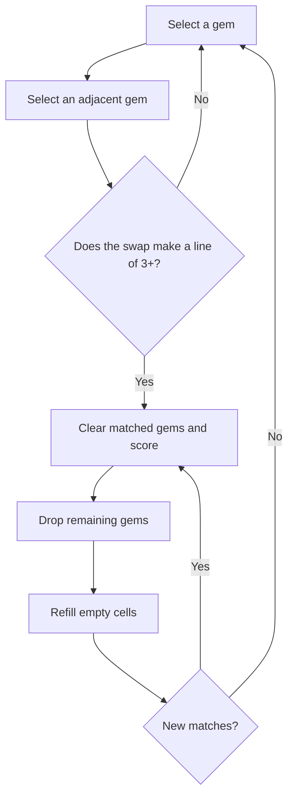

# Gleam Grid

A little light, a lot of spark. **Gleam Grid** is an original, responsive match-three puzzle built with Vue 3, TypeScript, and Vite.

Play it on [GitHub Pages](https://oscarmmi.github.io/match-3/).

## How to play

- Swap two neighboring gems by clicking or tapping one, then its neighbor.
- A swap is accepted only when it creates a horizontal or vertical line of at least three matching gems.
- Matched gems clear, gems above fall, and new gems arrive from the top. Cascades score more with each chain.
- Each gem cleared is worth 10 points, multiplied by the cascade number.
- Your best score is saved in this browser.
- Use arrow keys to move the highlight, Enter or Space to select, and R to start a fresh board.

## Run locally

```sh
npm install
npm run dev
```

Run the game-logic tests and production build with:

```sh
npm test
npm run build
```

## Game loop



## Built with

Vue 3 · TypeScript · Vite · Vitest
